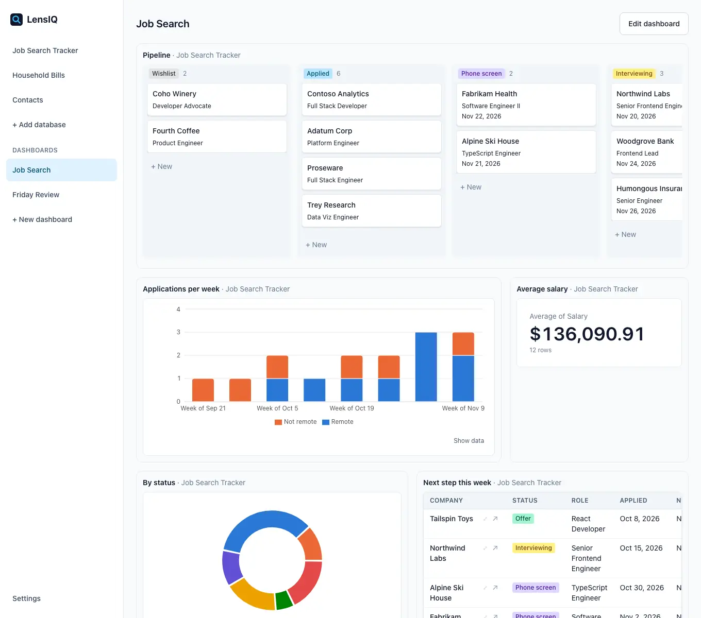
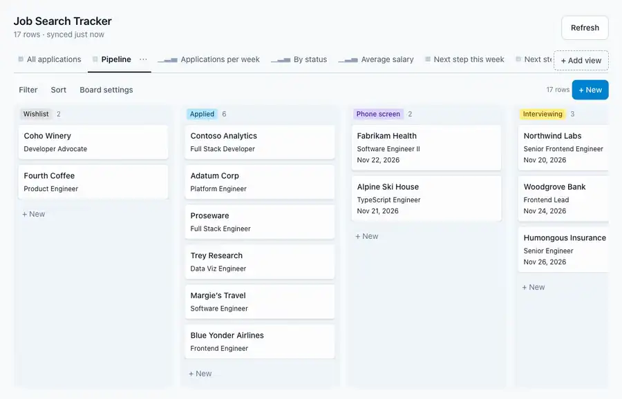
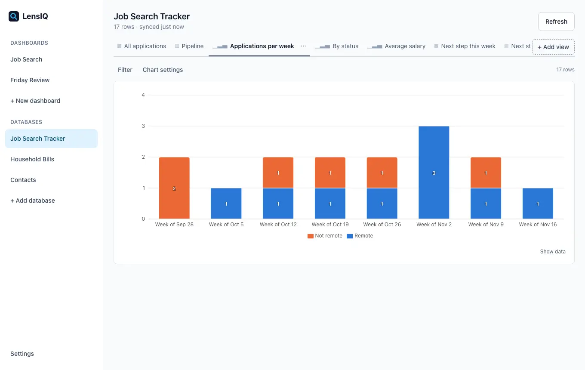
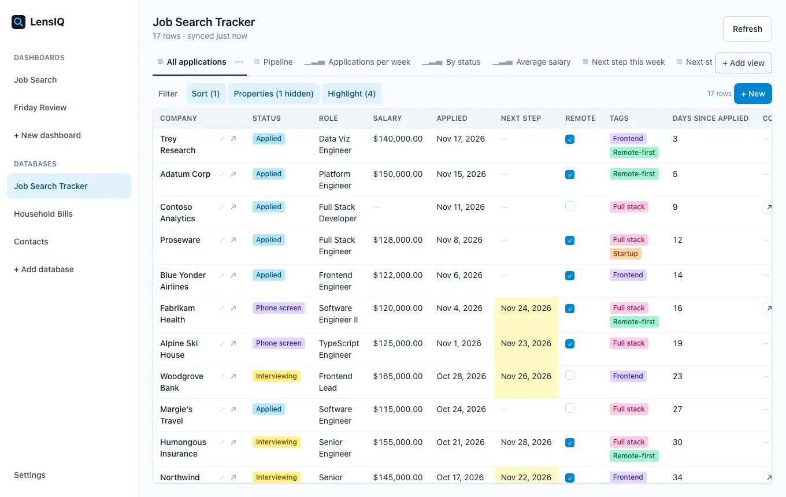
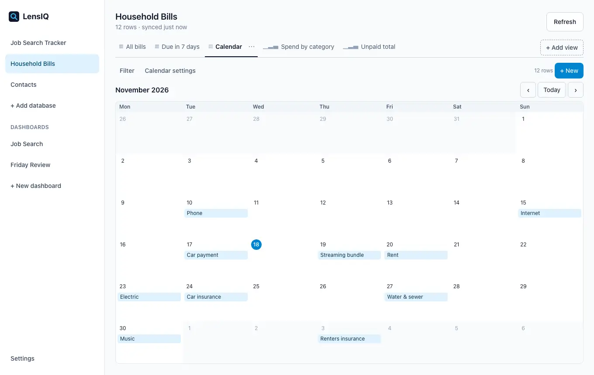
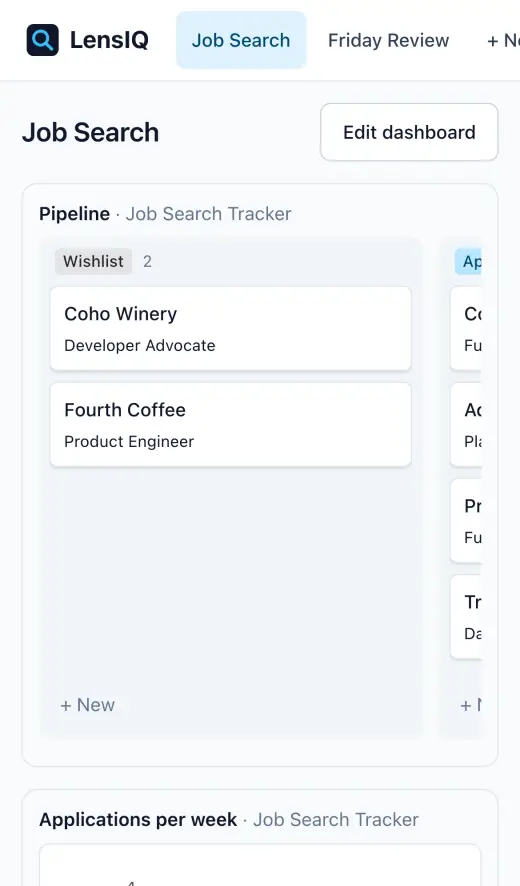
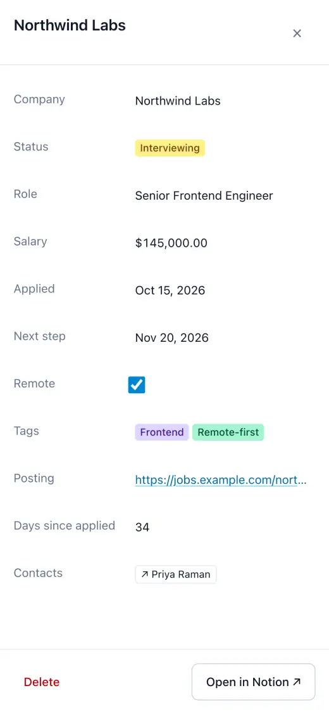
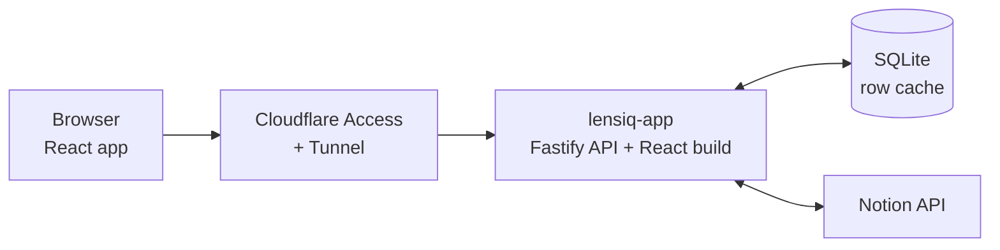

# LensIQ

**Self-hosted dashboards for Notion:** tables, boards, charts and calendars over your Notion databases, edited in place and written straight back to Notion. React, Node, Docker.

**[Try the live demo →](https://bobbyjoecool.github.io/LensIQ/)** (made-up sample data, runs entirely in your browser, resets on reload)



Notion's free plan allows one chart. LensIQ keeps Notion as the data store and adds the views a paid plan would: it reads each database's schema and builds every view from it, so connecting a new database means pasting its link, not writing code.

<table>
  <tr>
    <td width="50%"><br><sub>Drag a card to change its status. The edit goes to Notion.</sub></td>
    <td width="50%"><br><sub>Charts: bar, line, area, donut and number tiles.</sub></td>
  </tr>
  <tr>
    <td><br><sub>Typed table with filters, sorts and inline editing.</sub></td>
    <td><br><sub>Calendar by any date column; drag rows between days.</sub></td>
  </tr>
</table>

<p>
  
  
</p>

## Features

- **Edit Notion from LensIQ.** Change cells inline (or in a row panel on a phone), add rows, delete rows to Notion's trash, and create new select options as you type.
- **No silent overwrites.** Before every write, the API re-reads the page; if that cell changed in Notion meanwhile, you pick which value to keep.
- **Notion-style views.** Table, board, chart and calendar tabs on each database, each with its own filters (and/or), sorts and settings.
- **Dashboards.** Any number of pages mixing views from any databases, in a grid that stacks to one column on a phone.
- **Relations and files.** Linked pages show by title and edit with a searchable picker; file links always open a fresh download URL.
- **Installable.** Add it to the iPhone home screen as an app.
- **Backups.** Export and import every view and dashboard as JSON.

> **Status: Phase 5 of 5 (polish).** Everything above is built and tested; see the [issues](https://github.com/BobbyJoeCool/LensIQ/issues).

## How it works



- The browser only talks to the LensIQ API. The Notion token stays on the server.
- The API reads a data source's schema and rows from Notion, normalizes every property type into a small set of cell shapes, and caches them in SQLite.
- Formulas and rollups come from Notion already calculated; LensIQ never re-implements Notion's math.
- **Edits go straight to Notion.** Each edit shows on screen at once, then the API reads the page from Notion and compares the edited cell with the value you started from. If someone changed that cell in Notion meanwhile, you choose which value to keep instead of overwriting it silently. Changes to other columns don't count as conflicts.
- **Staying in sync.** Opening a database shows the cached rows instantly and does a full reload behind them. While it stays open, LensIQ asks Notion every 60 seconds for rows edited since the last sync.
- **Views, like Notion's.** Each database has view tabs (Table, Board, Chart) with their own filters, sorts and settings, saved in SQLite. Views store column IDs, never names, so renaming a column in Notion doesn't break them; a view that points at a deleted column says so instead of crashing. Filtering, sorting and chart math run in the browser on the cached rows, so changing a view costs no Notion requests.
- **Charts.** Bar (vertical, horizontal, stacked), line, area (with running totals), donut and number tiles; count, sum, average, min or max; dates grouped by day, week, month or year; split by a select. Colors come from an eight-slot palette checked for color-vision deficiency in light and dark mode, and each Notion option keeps its own color. Every chart has a "Show data" table.
- **Relations and files.** Relation columns show linked page titles (read from the related database on each full sync, about one request per 100 pages) and edit with a searchable picker. Notion-hosted file links expire after an hour, so file links go through the API, which reads the page again and redirects to a fresh URL.
- **Calendar.** Rows on a month grid by any date column; drag a row to another day (ranges keep their length), or "+" to add a row on a day. On a phone it's an agenda list.
- **Dashboards.** Any number of named pages, each a grid of views from any databases (a third, half, two thirds or full width), stacking to one column on a phone.
- **Rate limit.** Every Notion request goes through one limiter that spaces requests about 400 ms apart (≈2.5/s, under Notion's 3/s average). The Notion SDK retries 429 responses, honoring `Retry-After`.
- Every `/api` request must carry a valid Cloudflare Access JWT, so the app can't be reached by going around Cloudflare.
- **The public demo** is the same React app built with `VITE_DEMO=1`: a small in-browser server (`web/src/demo/`) answers its `/api` calls from fictional sample data, so it needs no Notion token or backend and is published to GitHub Pages by a workflow on every push to `main`. The demo code isn't in the normal build.

## Stack

| Layer | Choice |
| --- | --- |
| Front end | React 19, Vite, TypeScript, Tailwind CSS, TanStack Query |
| API | Node 22, Fastify 5, TypeScript, `@notionhq/client` (Notion API `2025-09-03`) |
| Charts and boards | Recharts (loaded only when a chart is on screen), dnd-kit |
| Storage | SQLite via `better-sqlite3` |
| Auth | Cloudflare Access (JWT verified with `jose`) |
| Tests | Vitest + Testing Library (unit), Playwright (end-to-end, desktop and mobile) |
| Deploy | One `node:22-alpine` image, Docker Compose, Cloudflare Tunnel; demo on GitHub Pages |

## Repository layout

```text
api/        Fastify API: Notion module, SQLite store, routes, Access check
  test/     Unit tests, plus the fixture Notion source and server used by E2E
web/        React app (Vite); web/src/demo/ is the in-browser server for the public demo
shared/     TypeScript types shared by api and web (type-only)
e2e/        Playwright end-to-end tests
deploy/     compose.yaml, deploy.sh and the deployment runbook
scripts/    Smoke test for the compiled server, app icon renderer
docs/media/ README screenshots and animations (WebP)
.github/    Workflow that publishes the demo to GitHub Pages
```

## Running locally

Requires Node 22 or later.

```bash
npm install
cp .env.example .env        # then paste a Notion internal integration secret
npm run dev                 # API on :3000, web app on http://localhost:5173
```

`npm run dev` sets `NODE_ENV=development`, the only mode that skips the Cloudflare Access check. In any other mode the server refuses to start without `CF_ACCESS_TEAM_DOMAIN` and `CF_ACCESS_AUD`.

To connect a database: in Notion, open it, choose **··· → Connections**, add your integration, then paste the database link into **Add database**.

## Tests

```bash
npm test             # unit tests (API and web)
npm run test:e2e     # builds, smoke-tests the compiled server, then runs Playwright
npm run typecheck
```

The E2E tests run the real API and built React app against a fixture Notion source with fictional data, so they need no Notion token or network. They run on desktop Chrome and a Pixel 7, plus a third project against the static demo build served under `/LensIQ/` the way GitHub Pages serves it.

```bash
npm run build:demo   # static demo in web/dist-demo
```

## API

| Method | Path | Purpose |
| --- | --- | --- |
| `GET` | `/api/health` | Health check (no auth; used by Docker) |
| `GET` | `/api/databases` | Connected databases |
| `POST` | `/api/databases` | Connect a database: `{ "idOrUrl": "<Notion link, database ID or data source ID>" }` |
| `GET` | `/api/databases/:id` | One database with its schema |
| `GET` | `/api/databases/:id/rows?sync=none\|changes\|full` | Schema and rows. `none` serves the cache, `changes` first fetches rows edited since the last sync, `full` reloads everything. A never-loaded database always gets a full load. |
| `POST` | `/api/databases/:id/refresh` | Full reload from Notion |
| `POST` | `/api/databases/:id/rows` | Create a row: `{ "cells": { "<columnId>": <cell value> } }` |
| `PATCH` | `/api/databases/:id/rows/:pageId` | Set one cell: `{ columnId, value, expected, force? }`. Answers `409` with Notion's current value if that cell changed since `expected`. |
| `DELETE` | `/api/databases/:id/rows/:pageId` | Move a row to Notion's trash |
| `GET` | `/api/databases/:id/relations/:columnId` | Titles of a relation column's related pages: `{ available, options: [{ id, title }] }` |
| `GET` | `/api/databases/:id/rows/:pageId/files/:columnId/:index` | Redirects to a freshly signed URL for a Notion-hosted file |
| `GET` | `/api/views?databaseId=` | Views of a database in tab order (a default Table view is created the first time), or every view |
| `POST` / `PATCH` / `DELETE` | `/api/views`, `/api/views/:id` | Create a view (`databaseId`, `name`, `type`, optional `config`); change its name, settings or tab position; delete it (and its dashboard tiles) |
| `GET` / `POST` | `/api/dashboards` | List or create dashboards |
| `GET` / `PATCH` / `DELETE` | `/api/dashboards/:id` | One dashboard; rename it or replace its tiles (`{ viewId, size }` in order); delete it |
| `GET` | `/api/export` | Every view and dashboard as one JSON file |
| `POST` | `/api/import` | Add the views and dashboards from an export (databases matched by Notion ID; others skipped) |

## Deployment

See [deploy/README.md](deploy/README.md): one container behind a Cloudflare Tunnel with Cloudflare Access, a one-line deploy, and nightly backups of `data/`.
