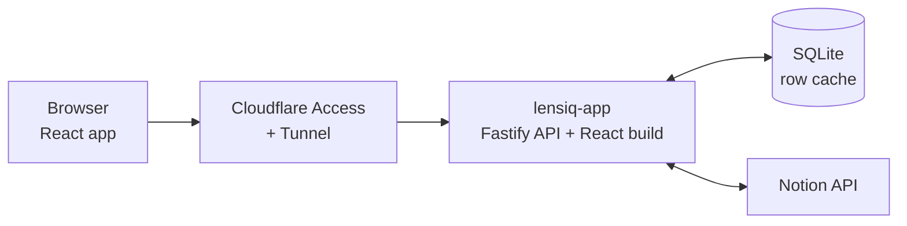

# LensIQ

Self-hosted dashboards for Notion: tables, boards and charts over your Notion databases. React, Node, Docker.

Notion's free plan allows one chart. LensIQ keeps Notion as the data store and adds the views on top: it reads each database's schema and builds its table from that, so connecting a new database means pasting its link, not writing code.

> **Status: Phase 2 of 5 (editing).** Connect a Notion database, browse it as a typed table on a phone or laptop, and edit it: change cells inline, add rows, and delete rows, with every change written straight to Notion. Boards, charts and dashboards come next; see the [issues](https://github.com/BobbyJoeCool/LensIQ/issues).

## How it works



- The browser only talks to the LensIQ API. The Notion token stays on the server.
- The API reads a data source's schema and rows from Notion, normalizes every property type into a small set of cell shapes, and caches them in SQLite.
- Formulas and rollups come from Notion already calculated; LensIQ never re-implements Notion's math.
- **Edits go straight to Notion.** Each edit shows on screen at once, then the API reads the page from Notion and compares the edited cell with the value you started from. If someone changed that cell in Notion meanwhile, you choose which value to keep instead of overwriting it silently. Changes to other columns don't count as conflicts.
- **Staying in sync.** Opening a database shows the cached rows instantly and does a full reload behind them. While it stays open, LensIQ asks Notion every 60 seconds for rows edited since the last sync.
- **Rate limit.** Every Notion request goes through one limiter that spaces requests about 400 ms apart (≈2.5/s, under Notion's 3/s average). The Notion SDK retries 429 responses, honoring `Retry-After`.
- Every `/api` request must carry a valid Cloudflare Access JWT, so the app can't be reached by going around Cloudflare.

## Stack

| Layer | Choice |
| --- | --- |
| Front end | React 19, Vite, TypeScript, Tailwind CSS, TanStack Query |
| API | Node 22, Fastify 5, TypeScript, `@notionhq/client` (Notion API `2025-09-03`) |
| Storage | SQLite via `better-sqlite3` |
| Auth | Cloudflare Access (JWT verified with `jose`) |
| Tests | Vitest + Testing Library (unit), Playwright (end-to-end, desktop and mobile) |
| Deploy | One `node:22-alpine` image, Docker Compose, Cloudflare Tunnel |

## Repository layout

```text
api/        Fastify API: Notion module, SQLite store, routes, Access check
  test/     Unit tests, plus the fixture Notion source and server used by E2E
web/        React app (Vite)
shared/     TypeScript types shared by api and web (type-only)
e2e/        Playwright end-to-end tests
deploy/     compose.yaml, deploy.sh and the deployment runbook
scripts/    Smoke test for the compiled server
```

## Running locally

Requires Node 22 or later.

```bash
npm install
cp .env.example .env        # then paste a Notion internal integration secret
npm run dev                 # API on :3000, web app on http://localhost:5173
```

`npm run dev` sets `NODE_ENV=development`, the only mode that skips the Cloudflare Access check. In any other mode the server refuses to start without `CF_ACCESS_TEAM_DOMAIN` and `CF_ACCESS_AUD`.

To connect a database: in Notion, open it, choose **··· → Connections**, add your integration, then paste the database link into **Add database**.

## Tests

```bash
npm test             # unit tests (API and web)
npm run test:e2e     # builds, smoke-tests the compiled server, then runs Playwright
npm run typecheck
```

The E2E tests run the real API and built React app against a fixture Notion source with fictional data, so they need no Notion token or network.

## API

| Method | Path | Purpose |
| --- | --- | --- |
| `GET` | `/api/health` | Health check (no auth; used by Docker) |
| `GET` | `/api/databases` | Connected databases |
| `POST` | `/api/databases` | Connect a database: `{ "idOrUrl": "<Notion link, database ID or data source ID>" }` |
| `GET` | `/api/databases/:id` | One database with its schema |
| `GET` | `/api/databases/:id/rows?sync=none\|changes\|full` | Schema and rows. `none` serves the cache, `changes` first fetches rows edited since the last sync, `full` reloads everything. A never-loaded database always gets a full load. |
| `POST` | `/api/databases/:id/refresh` | Full reload from Notion |
| `POST` | `/api/databases/:id/rows` | Create a row: `{ "cells": { "<columnId>": <cell value> } }` |
| `PATCH` | `/api/databases/:id/rows/:pageId` | Set one cell: `{ columnId, value, expected, force? }`. Answers `409` with Notion's current value if that cell changed since `expected`. |
| `DELETE` | `/api/databases/:id/rows/:pageId` | Move a row to Notion's trash |

## Deployment

See [deploy/README.md](deploy/README.md).
